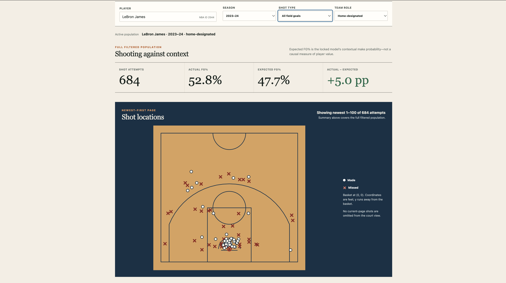

# HoopsLab

[](https://github.com/hamzaAhmed21st/hoopslab/actions/workflows/ci.yml)

Explore NBA shooting across six seasons. Search for a player, filter their shots, and compare actual shooting with a model's expected make probability on an interactive court.

**Python · FastAPI · PostgreSQL · scikit-learn · React · TypeScript**

## Dashboard preview



[Run locally](#run-locally) · [Implementation and tests](docs/EVIDENCE.md) · [Architecture](docs/architecture.md)

## From source data to shot chart

- **Reliable imports:** six revision-pinned NBA seasons, validated with SHA-256, schema, and row-count checks. Each season imports in one transaction; repeat imports are skipped and conflicting source records are rejected.
- **Separate model development and evaluation:** chronological whole-game splits keep training, calibration, selection, and the final test season separate. The selected model is locked before final evaluation.
- **A working analytics application:** FastAPI serves single/batch predictions and PostgreSQL-backed player summaries. The React dashboard includes player search, filters, a custom SVG court, and paginated shots.

The [implementation guide](docs/EVIDENCE.md) links each part to its code and tests, including rollback checks against PostgreSQL and a synthetic develop/lock/evaluate test.

## Held-out result

The original August 12, 2026 evaluation covers **218,701 shots from 1,230 games** in the held-out 2023–24 season. The selected calibrated gradient-boosting model achieved lower log loss than the calibrated logistic comparator:

| Model | Log loss ↓ | Brier score ↓ | ROC-AUC ↑ |
| --- | ---: | ---: | ---: |
| Histogram gradient boosting + sigmoid calibration | 0.637055 | 0.224358 | 0.657832 |
| Logistic regression + isotonic calibration | 0.642787 | 0.226538 | 0.650390 |

[Original evaluation report](docs/evidence/final-test-report.json) · [Model and data provenance](docs/evidence/provenance.json) · [Evaluation details](docs/EVIDENCE.md#model-results-and-reproducibility)

These are recorded local results. The published report and provenance document the run; public CI does not retrain the full model or reproduce its scores.

## Stack

- Backend: Python 3.13, uv, Pydantic, PyArrow, SQLAlchemy, Alembic, PostgreSQL,
  scikit-learn, FastAPI, pytest, Ruff, and mypy.
- Frontend: React, strict TypeScript, Vite, pnpm, TanStack Query, Vitest, and
  Testing Library.
- Runtime: separate FastAPI and nginx images composed with PostgreSQL; nginx
  provides the dashboard's same-origin `/api` and `/health` proxy.

## Data provenance

The source contract uses completed-season `shotdetail` Parquet snapshots from
the [NBA Data Archive](https://huggingface.co/datasets/cdechoch/nba-data-archive),
which mirrors Vladislav Shufinskiy's
[Apache-2.0 archive](https://github.com/shufinskiy/nba_data). Source revisions
and file hashes for the completed 2018-19 through 2023-24 regular seasons are
pinned in code before they are accepted. External source data and generated
feature/quality artifacts remain in ignored local directories.

The pinned revision and file hashes define which inputs HoopsLab accepts; raw
data and generated datasets remain outside Git. The underlying statistics
originate from NBA public services. HoopsLab is a non-commercial portfolio
project, attributes NBA.com, and does not redistribute the dataset, logos,
video, or play-by-play. Review the current
[NBA.com Terms of Use](https://www.nba.com/termsofuse) before reuse.

## Run locally

Requirements: uv, Docker with Compose, Git, Node.js 24 LTS, and pnpm 11.20.0.

**A fresh clone does not include the data or trained model.** You can run the automated checks without the full NBA dataset. The full dashboard needs an ingested database and compatible local model artifacts.

These commands have been checked against the current scripts and configuration, but a fresh-clone walkthrough with the full dataset has not been executed.

### Install and prepare the database

```bash
uv sync --locked --all-groups
cd frontend && CI=true pnpm install --frozen-lockfile && cd ..
cp .env.example .env
docker compose up -d --wait db
uv run alembic upgrade head
```

### Build data and model artifacts

If you already have the original compatible local database and model artifacts, skip this step and start the application. Otherwise, the data pipeline is:

```bash
make source-validate
make ingest
make quality
make features
```

For a new local modeling run, use the default ignored artifact directory only if it has no existing locked selection or final report:

```bash
make develop-model
make verify-model
```

Inspect the generated `artifacts/modeling/selection-lock.json` and development results before locking the selection. Then run:

```bash
make lock-model
make evaluate-model
make verify-model
```

The scripts reject redevelopment after locking and refuse to overwrite a final report. Keep existing results intact. A new run is a new experiment, not a replacement for the published historical report.

The [API runtime](backend/src/hoopslab/api/runtime.py) checks the selected model configuration and expected data segments as well as matching artifact hashes. Generating a different valid model does not automatically make it compatible with this API. Full-data setup and training take additional time; this is not a prepackaged demo.

### Start the application

With the database and compatible artifacts available, run these in separate terminals:

```bash
make api
make frontend
```

Dashboard: <http://localhost:5173>. API documentation: <http://localhost:8000/docs>.
For the containerized stack, use `make stack-up` instead.

Without compatible model artifacts, the API answers `/health/live`, while readiness and model-dependent routes return 503. Startup does not download or train a model.

## Tests

```bash
make check
make test              # PostgreSQL integration tests; migrate the database first
make frontend-check
docker compose config
```

CI checks the backend and frontend, migrations, and container builds. The [recorded test results](docs/EVIDENCE.md#recorded-ci-evidence) include 79 backend passes, one skipped real-model smoke test, and 26 frontend passes at the linked historical commit.

## Interpreting the results

Expected FG% describes a shot's contextual make probability. The model excludes player/team identities and lacks defender, lineup, and score context, so actual-versus-expected comparisons are descriptive rather than causal player rankings. Discrimination is weaker for three-point and midrange attempts; home/away is the nominal schedule role during the 2020 bubble.
